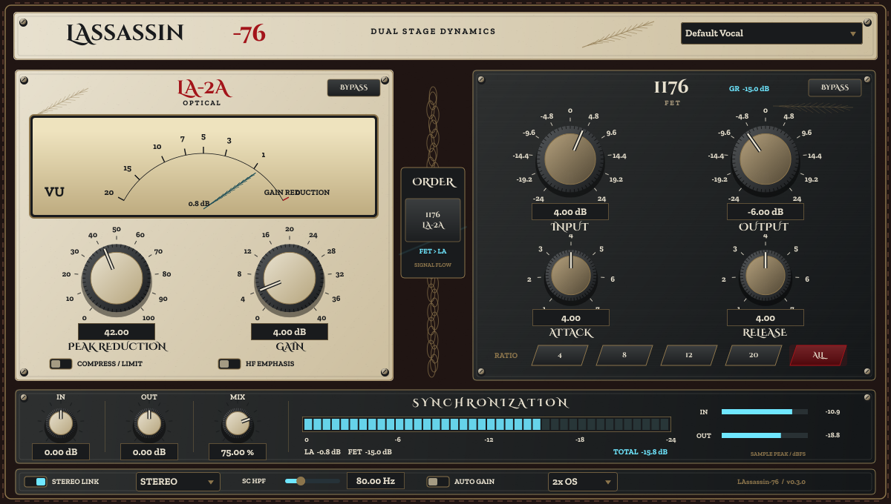

# LAssassin-76

JUCE optical + FET compressor with attributed open-source DSP sections: the familiar **1176 → LA-2A** serial vocal chain in one plugin, with reversible order and independent controls.

[Downloads](https://github.com/yunm4833-design/LAssassin-76/releases) · [中文 DSP / calibration documentation](README.zh-CN.md) · [Installation](Documentation/INSTALL.md)



## Platforms

| Package | Formats | Architecture |
|---|---|---|
| Windows 10/11 | VST3 | x64 |
| macOS 11+ | VST3, Audio Unit | Universal: Apple Silicon + Intel |

macOS testing packages are ad-hoc signed, not Developer ID signed or notarized. Read the installation notes. Stereo tracks/buses only.

## UI

Ivory optical panel, black steel FET section, feather VU, blade ratio buttons, red All mode, cyan GR feedback and animated order switching. The original photorealistic reference now supplies an embedded parchment/steel backplate and textured knob atlas, with live **Zilla Slab Bold** numeric readouts. **SETUP** reveals presets, HPF, Link, Auto Gain, channel mode and oversampling. LA Gain uses a 0–100 faceplate scale (host parameter remains 0–40 dB). No official game assets or logos.

## Build

C++17, CMake 3.22+, JUCE 8.0.6 (fetched automatically, or `-DJUCE_PATH=/path/to/JUCE`).

```sh
cmake -S . -B build -DCMAKE_BUILD_TYPE=Release -DLASSASSIN_BUILD_STANDALONE=OFF
cmake --build build --config Release --parallel 2
ctest --test-dir build -C Release --output-on-failure
```

Windows: use Visual Studio 2022 C++ Desktop tools, `-G "Visual Studio 17 2022" -A x64`, or `scripts/build-windows.ps1`.
macOS: Xcode command-line tools; add `-DCMAKE_OSX_ARCHITECTURES="arm64;x86_64" -DCMAKE_OSX_DEPLOYMENT_TARGET=11.0` for Universal bundles.
Linux developer dependencies and detailed DSP constants are documented in README.zh-CN.md.

GitHub Actions builds both native platforms. Tags matching the CMake version (`v0.4.0`) or a manual publish dispatch create a prerelease after all build and validation gates pass. Each package includes its matching source tag and license notices.

## Model and validation limits

Two-state T4 recovery plus adapted ZeroComp LDR heat memory; feedback FET detection; adapted MIT shunt-JFET gain cell and Jiles-Atherton core; oversampling; linked/dual-channel or M/S; HPF; dry alignment; slow RMS auto compensation. This is a behavior model with attributed circuit sections, not a hardware-calibrated complete circuit replica. See VALIDATION.md for what was actually checked. No commercial DAW compatibility certification is claimed.

## License

Project source: **AGPL-3.0-or-later**. JUCE uses its AGPL option. Fonts retain **SIL OFL 1.1**. See LICENSE and THIRD_PARTY_NOTICES.md.

## SignalTrain measurement report

[中文校准报告](Documentation/Calibration/REPORT.zh-CN.md) compares the v0.4.0 optical core against three SignalTrain hardware operating points, with held-out time windows and a fixed-gain control. Offline candidate profiles improve some errors but are not enabled in released binaries. [Reproduction scripts](tools/calibration/README.md).
